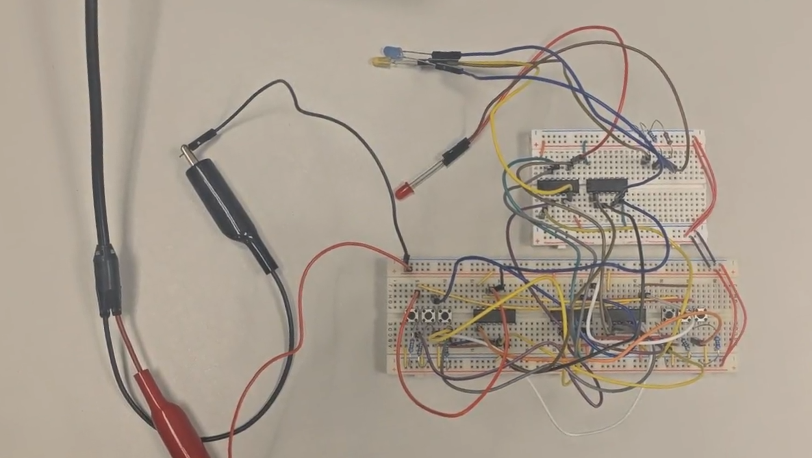
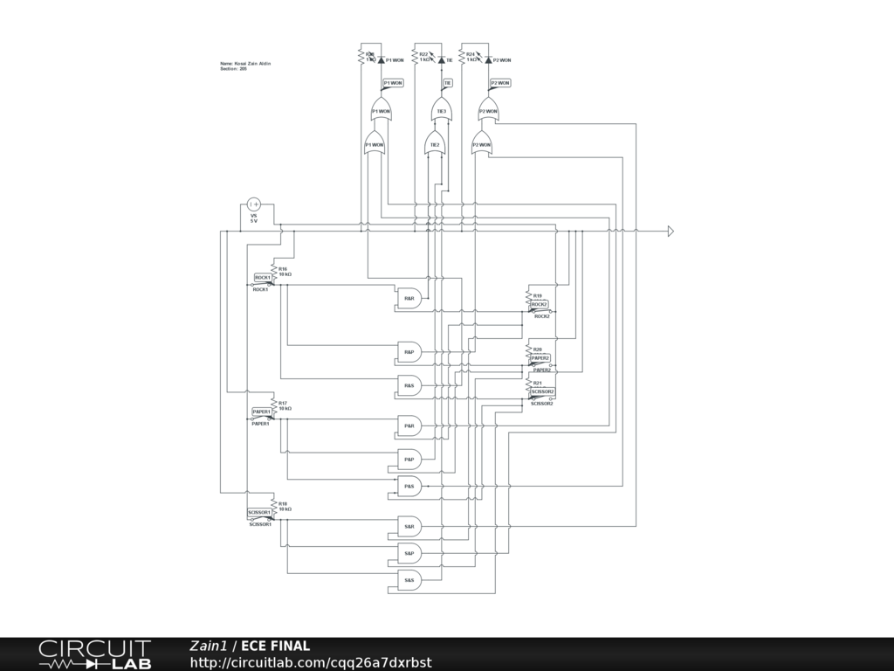

# Rock Paper Scissors Logic Gate Board

A two-player Rock Paper Scissors game built entirely from digital logic gates, with no microcontroller or code. Designed and simulated in Tinkercad Circuits, then built as a physical circuit. This was my final project for **ECE 101**.



## Project Overview

The goal of this project was to implement the rules of Rock Paper Scissors using a logic gate board. Each player's choice is a digital input, and logic gates evaluate the possible outcomes.

The circuit follows the game's rules:

| Matchup | Result |
|---|---|
| Rock vs. Scissors | Rock wins |
| Scissors vs. Paper | Scissors wins |
| Paper vs. Rock | Paper wins |
| Same choice | Tie |

## How It Worked

Each player has three push button: **Rock**, **Paper**, and **Scissors**. Each switch has a 10 kΩ resistor so the input reads a clean 0 or 1 when the switch is not pressed.

The circuit has three stages:

1. **Inputs:** 6 switches (3 per player) on a 5 V supply.
2. **Matchup detection:** 9 AND gates, one for every possible matchup (R&R, R&P, R&S, P&R, P&P, P&S, S&R, S&P, S&S). An AND gate outputs 1 only when both players pick its two choices.
3. **Result:** OR gates combine the matchups that lead to the same outcome into three results, shown on LEDs (each with a 1 kΩ resistor): **P1 WON**, **TIE**, and **P2 WON**.

### Truth table

| Player 1 | Player 2 | Result |
|---|---|---|
| Rock | Rock | Tie |
| Rock | Paper | P2 wins |
| Rock | Scissors | P1 wins |
| Paper | Rock | P1 wins |
| Paper | Paper | Tie |
| Paper | Scissors | P2 wins |
| Scissors | Rock | P2 wins |
| Scissors | Paper | P1 wins |
| Scissors | Scissors | Tie |

## Schematic

The circuit was designed and simulated in two tools: **CircuitLab** (full circuit) and **Tinkercad Circuits**.

### CircuitLab

[]

[Open the interactive schematic on CircuitLab]([https://www.circuitlab.com/circuit/qq26a7dxrbst/ece-final/](https://www.circuitlab.com/circuit/qq26a7dxrbst/ece-final/)

### Tinkercad

- [View the Tinkercad schematic (PDF)](schematics/rock-paper-scissors-logic-board.pdf)
- Tinkercad project link: *(add your link here, or delete this line)*

## Parts Used

- 6 switches (3 per player), each with a 10 kΩ resistor
- 9 AND gates and OR gates (logic gate ICs, *add part numbers, e.g. the 74HC series*)
- 3 LEDs (P1 WON, TIE, P2 WON), each with a 1 kΩ resistor
- 5 V power supply
- Breadboard and jumper wires

## Engineering Concepts

This project connected digital electronics with logical problem solving. It involved:

- Binary representation
- Boolean logic
- Logic gates
- The relationship between circuit inputs and outputs

It also demonstrated how a set of rules can be translated into a hardware system.

## What I Learned

The project gave me practical experience connecting digital logic concepts to a physical engineering application. It showed how logic circuits process inputs and produce outputs based on predefined conditions, an important foundation for computer engineering and digital system design.

## Course Info

- **Course:** ECE 101
- **Instructor:** *(add name)*
- **School:** *(add school)*
- **Term:** *(e.g. Fall 2026)*
- **Project:** Final project
- **Grade:** 105.5/100 (included extra credit for designing it in Tinkercad)

## Repository Structure

```
.
├── README.md
├── images/
│   ├── board-photo.jpg
│   └── circuitlab-schematic.png
└── schematics/
    └── rock-paper-scissors-logic-board.pdf
```
